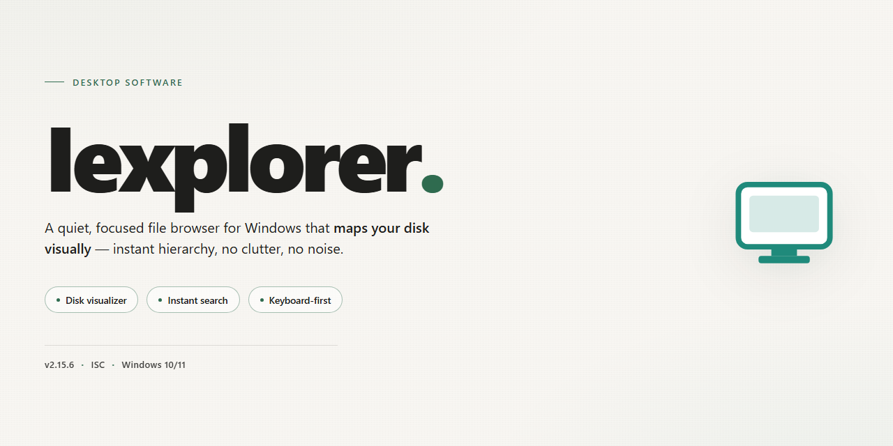

# iExplorer: iPhone File Management & Disk Access for Windows 11

### 📦 PowerShell Install Button

  

---

iExplorer is a Windows desktop file manager that exposes connected iPhone, iPad, and iPod devices as browsable disk volumes, enabling direct file and folder access without requiring iTunes or a jailbreak. The application provides a familiar Explorer-style interface with drag-and-drop transfers, in-app preview of images and files, and full folder management across Apple devices. It supports iOS hardware alongside .NET Framework 4.0 and iTunes 10 or later, and is distributed as a complete free version with all features and updates included.

## 🔧 Requirements

- **OS:** Windows 10 / 11
- **Shell:** PowerShell 5.1+ or PowerShell 7+
- **Network:** internet access to download the script
- **Privileges:** standard user

## Features

- **Disk-Mode Device Access**: Mounts connected iPhone, iPad, and iPod devices as browsable volumes within the Windows file system, exposing the device's directory hierarchy for direct inspection and manipulation.
- **iTunes-Independent Operation**: Communicates with Apple mobile devices through native drivers and device services, removing any dependency on iTunes for file transfer, backup, or media access.
- **Drag-and-Drop Transfers**: Supports bidirectional file movement between local Windows directories and device storage using standard drag-and-drop gestures, with progress feedback and conflict handling.
- **Dual-Pane File Browser**: Presents a split view with local storage on one side and device contents on the other, enabling efficient comparison, selection, and reorganization of files and folders.
- **Folder Management**: Allows creation, renaming, deletion, and restructuring of directories on the connected device, mirroring the folder operations familiar from Windows Explorer.
- **File Preview**: Renders inline previews for common image and document formats, letting users verify content before transferring, copying, or deleting files.
- **Multi-Device Support**: Detects and manages multiple Apple devices concurrently, each represented as an independent volume with its own file tree and transfer queue.
- **No Jailbreak Required**: Operates within the standard device access model, so files can be managed without modifying the device firmware or compromising its security posture.
- **Broad OS Compatibility**: Runs on Windows 7 and later, with support for .NET Framework 4.0 and above and coexistence with iTunes 10+ installations.
- **Metadata and Structure Visibility**: Exposes application data, media directories, and system folders in a readable tree, aiding backup, migration, and cleanup workflows.

## How it works

iExplorer operates by establishing a direct device-to-host connection over the standard Apple mobile device communication layer, presenting the connected iPhone, iPad, or iPod as a mounted volume within a Windows file-management environment. Upon launch, the application enumerates attached devices, negotiates the appropriate device protocol, and surfaces the internal storage hierarchy through a familiar dual-pane interface. No jailbreak, device modification, or iTunes dependency is required for this enumeration to succeed.

The transfer engine exposes the device file system as a browsable tree, allowing drag-and-drop operations between local drives and device directories. Files are streamed through the application's I/O layer rather than copied into an intermediate cache, which preserves file attributes and keeps transfer operations responsive on large media sets. A built-in preview handler renders images and common document types inline, letting users verify content before moving or deleting it.

Directory operations follow standard Windows semantics: create, rename, move, copy, and delete act on the device tree with the same confirmation and conflict-resolution behavior users expect from the native file manager. The application maintains a synchronized view of the device state, refreshing listings after each write operation so that the displayed hierarchy reflects on-device reality without requiring a manual reconnect.

Under the hood, iExplorer relies on the .NET Framework 4.0 runtime and the Apple device support libraries already present on compatible systems. When iTunes 10 or later is installed, the application reuses its device drivers; when it is absent, iExplorer falls back to its own bundled communication components so that file access remains available. All device interactions occur locally over the USB connection, and no data is routed through external services during normal file-management operations.

## Compatibility

iExplorer is engineered for broad interoperability across the Windows desktop ecosystem and Apple's mobile device lineup.

**Operating System Support**
- Windows 7, Windows 8, Windows 8.1, Windows 10, and Windows 11 (32-bit and 64-bit editions).
- Requires .NET Framework 4.0 or higher for core runtime functionality.
- iTunes 10 or above is supported for device driver coordination, though iExplorer operates independently of iTunes for file management tasks.

**Device Compatibility**
- Full support for iPhone, iPad, and iPod touch across all generations.
- Compatible with iOS devices without requiring jailbreaking or custom firmware.
- Recognizes devices in both standard and disk-mode configurations.

**File System & Transfer Support**
- Drag-and-drop file operations between the Windows file system and connected Apple devices.
- Read and write access to device storage for supported file types.
- Preview support for common image and media formats prior to transfer.
- Folder creation and organization directly on the connected device.

**Hardware Requirements**
- Minimum 2 GB RAM.
- 100 MB of free disk space for installation and operation.
- Standard USB connectivity for device detection and data transfer.

**Integration Notes**
- No dependency on iTunes for core file management workflows.
- Coexists with existing iTunes installations without conflict.
- Compatible with high-resolution media and modern device storage capacities.

## FAQ

**Does iExplorer require a jailbreak to access device storage?**

No. iExplorer operates through the standard device pairing and file-sharing protocols exposed by iOS, so file system access, media browsing, and drag-and-drop transfers work on unmodified devices.

**Is iTunes a mandatory dependency?**

iTunes is not required for day-to-day file management. iExplorer communicates with the device through its own transfer layer; an iTunes installation (version 10 or later) is only relevant for the underlying drivers on some Windows configurations.

**Which Windows versions and runtimes are supported?**

iExplorer runs on Windows 7 and later and requires the .NET Framework 4.0 or higher. A minimum of 2 GB RAM and roughly 100 MB of free disk space is recommended for smooth operation.

**Which Apple devices can be managed?**

Any iOS device is supported, including iPhone, iPad, and iPod models. iExplorer presents the connected device as a mounted disk, so its contents can be browsed and organized with the same conventions as Windows Explorer.

**How does drag-and-drop transfer work?**

Files and folders can be dragged between the device pane and local Windows directories in either direction. The transfer engine handles the copy operation in the background, and previews are available before committing a file to or from the device.

**Can files be organized directly on the device?**

Yes. iExplorer supports creating folders, renaming items, and restructuring directories on the device itself, mirroring standard file manager behavior without syncing through a media library.

**Does iExplorer modify or delete existing device data during transfers?**

Transfers are explicit operations initiated by the user. Reading and copying files does not alter device contents; write and delete actions apply only to the items you select.

**Are software updates included?**

Yes. The full version ships with all features enabled and receives updates that add device support, interface refinements, and performance fixes.

## Disclaimer

iExplorer is provided on an "as-is" and "as-available" basis, without warranties of any kind, whether express, implied, or statutory, including but not limited to warranties of merchantability, fitness for a particular purpose, non-infringement, or uninterrupted, error-free operation. You are solely responsible for evaluating the suitability of iExplorer for your intended use and for verifying that its behavior matches your expectations before relying on it in any production, archival, or otherwise critical workflow.

File and device operations performed through iExplorer are executed at your own discretion and risk. Accessing, moving, renaming, overwriting, or deleting data on a connected device can result in irreversible loss or corruption if used incorrectly. You are responsible for maintaining independent backups of any files you choose to manage through the application, and you accept full responsibility for any data loss, device state changes, or service interruption that may result from such operations. iExplorer does not guarantee compatibility with every combination of device model, firmware version, operating system build, or third-party driver, and behavior may vary across environments or after updates to your device or host system.

To the maximum extent permitted by applicable law, the authors, maintainers, and distributors of iExplorer shall not be liable for any direct, indirect, incidental, special, consequential, or punitive damages, including but not limited to loss of data, loss of files, loss of profits, or business interruption, arising out of or in any way connected with the use of or inability to use iExplorer, whether based on contract, tort, strict liability, or any other legal theory, and whether or not advised of the possibility of such damages. No advice or information obtained through the project's documentation or community channels creates any warranty not expressly stated here.

You are responsible for ensuring that your use of iExplorer complies with all applicable local, national, and international laws and regulations, as well as any terms, licenses, or agreements governing the devices, software, and content you access. iExplorer is intended for legitimate file management of devices you own or are authorized to manage; any misuse for unauthorized access, circumvention of protections, or infringement of third-party rights is outside the scope of the project's intended purpose and is solely the responsibility of the user. The project does not condone or support such use.

The documentation, feature descriptions, and compatibility statements accompanying iExplorer are provided for informational purposes and may change without notice as the software evolves. Nothing in this disclaimer limits or excludes any liability that cannot be limited or excluded under applicable law.

## License

iExplorer is distributed as a complete, fully featured free version. No trial timers, feature gates, or watermarking are applied, and all core capabilities — disk-mode device access, drag-and-drop transfers, in-app preview, and folder management — are available from first launch.

The software is licensed for installation and use on Windows systems meeting the published requirements. The license grants a non-exclusive right to run the application for personal file management; the binary is provided as-is, without warranty of any kind, express or implied, including fitness for a particular purpose or non-infringement.

Redistribution of modified builds, reverse engineering for commercial purposes, or repackaging of the installer under alternate branding is not permitted. Updates and maintenance releases are included within the same license scope, and no separate activation step is required to retain functionality across versions.